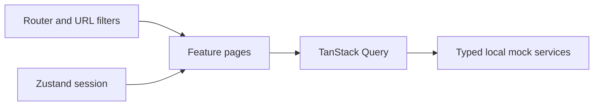

# React Operations Manager

A public React portfolio project for operational workflows. It is a clean-room implementation that uses only locally authored mock data.

Current status: demo sign-in and protected navigation, customer and activity lists/details, a fictional dashboard snapshot, and a reviewer-only decision queue are available. Lists use URL-backed search, filters, sorting, and pagination. All data stays in a local mock API. See [Product spec](docs/PRODUCT_SPEC.md).

## Implemented scope

[Live demo on Vercel](https://react-operations-manager.vercel.app/login)

Use the fictional reviewer or operator account listed below to explore the deployed app. Remote CI results and production browser workflows have not been verified in this documentation.

- Dashboard and operational summaries
- Customer directory and activity records
- Review queue with simulated mutations
- Protected routes, reviewer-only route, and mock session handling

## Local development

```bash
npm ci
npm run dev
```

Open the local URL shown by Vite. Demo accounts: `reviewer@demo.invalid` (review queue access) or `operator@demo.invalid` (browse only). Both use passcode `demo123`. These are public demo strings, not real credentials. The session is stored only in browser session storage.

In Customers, search by fictional name or ID, filter, sort, and open a detail. Activities has independent filtering, sorting, and detail views. The “Simulate service error” controls demonstrate the error state. No real network request is sent by the mock service.

Dashboard links to fictional records. Reviewers can approve, request information, or reject a case after explicit confirmation. The review state resets on reload. Returning from a filtered list detail preserves the URL filters. No real network request is sent by the mock service.

## Languages

English is the default; Traditional Chinese (`zh-TW`) and Simplified Chinese (`zh-CN`) are available on the login page and in the workspace header. The selection is saved locally without browser-language detection. Switching preserves the session, URL filters and review state. Navigation, forms, fictional record descriptions, errors and review feedback are translated. Arabic is exclusive to Client.

Source dictionaries and documented English fallback exceptions live under `src/i18n/messages/`. `scripts/build-locales.mjs` validates keys and interpolation and merges fallback text into complete dictionaries under `src/i18n/locales/`. Dynamic imports download only the chosen language; no additional English bundle is needed for fallback text. A failed switch preserves the current language and preference. Run `npm run test:i18n` to validate and regenerate dictionaries.

## Quality checks

Unexpected route/render failures show a safe recovery screen instead of a blank page. The demo does not expose internal error details or send them to an external service.

```bash
npm run typecheck
npm run lint
npm run format:check
npm run test
npm run build
```

## Browser verification

Local verification (2026-10-12): 39 Vitest tests and 10 Chromium E2E cases passed.
The browser cases cover five journeys at two viewport sizes, including translated review actions and single-language chunk loading.
Type checking, lint, formatting and production build are also checked.

Use Node.js 22.14 or newer in the Node 22 line. Install Chromium once, then run:

```bash
npx playwright install chromium
npm run test:e2e
```

The script builds the production bundle; Playwright setup starts and closes an in-process preview server on port 4173.
Five journeys run at desktop (1440 × 1000) and mobile (390 × 844) sizes.
Each test gets a fresh browser context. Vitest only collects tests under `src/`.
Failure traces and the HTML report stay in ignored `test-results/` and `playwright-report/` directories.
The GitHub workflow runs unit/component checks and Chromium journeys; remote CI status must be checked after pushing.

## Preview


These screenshots use fictional data. Regenerate them from the review confirmation browser journey after UI changes; its output includes `overview.png` for each viewport.

## Architecture and decisions



- The URL owns list filters, sorting and pagination. Details preserve the originating list query through router history state.
- TanStack Query owns request data and cache; Zustand owns browser session. Query results are not copied into Zustand.
- Mock reads accept `AbortSignal`; cleanup cancels pending timers. Retry policy distinguishes retryable service errors from missing records.
- Review mutations invalidate the review queue and dashboard. The mock service rejects already-decided cases to prevent duplicate changes.
- Out-of-range pages are corrected without removing filters. Unexpected rendering failures expose recovery controls.

## Two-minute walkthrough

1. Sign in as reviewer and open a filtered customer list. Open a detail and return with the filters intact.
2. Open Review queue, simulate a decision failure, then retry successfully. Return to Overview to see the pending count update.
3. Sign out and sign in as operator. Opening Review queue shows the access-denied page.

## Limits and next steps

This is a frontend demonstration. Route guards are not server authorization, and mock data is not shared between repositories.
Review decisions reset on full reload. There is no real review backend.
The app is deployed on Vercel. No real backend connection, token refresh or performance benchmark is claimed; production browser workflows remain unverified here.
Mobile verification uses a Chromium viewport, not a physical device or Safari.
Static hosting must rewrite application routes to `index.html` so direct links and refreshes work.
The local preview is available with `npm run build` followed by `npm run preview`.

No real API, account, transaction, or personal data is used or accepted by this project.
